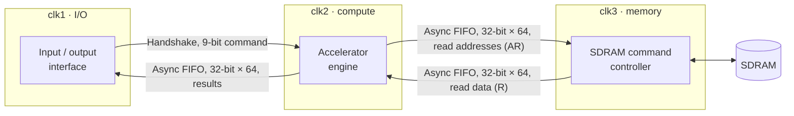

# Triple-Clock-Domain Accelerator with CDC

[中文版](README.zh-TW.md)

ICLAB Lab 07, Spring 2026 · Verilog · JasperGold CDC · Score 95 / 100

A compute block that reads its operands from DRAM, with the I/O interface, the compute engine and the DRAM controller each running on its own asynchronous clock. The focus of the lab is moving data safely and efficiently between those clocks.

## Clock domains and crossings

| Crossing | Synchronizer | Why this one |
| --- | --- | --- |
| clk1 → clk2, command | Handshake (req/ack through 2-flop synchronizers) | One small transfer at a time; a round trip of a few cycles is acceptable and costs little area |
| clk2 → clk1, results | Async FIFO, 64 entries | Results stream out back to back; a handshake per word would throttle throughput |
| clk2 → clk3, read addresses | Async FIFO, 64 entries | The engine queues many addresses ahead of the memory |
| clk3 → clk2, read data | Async FIFO, 64 entries | DRAM returns bursts that the engine consumes at its own rate |

## Key design points

- **Gray-coded FIFO pointers.** Each pointer crosses domains through a 2-flop bus synchronizer. Gray code changes one bit per increment, so a pointer sampled mid-transition is either the old or the new value, never an invalid mix. Full and empty are therefore conservative but never wrong.
- **Registered FIFO read data.** The dual-port memory output is registered once more in the read domain, so no unsynchronized path reaches read-side logic.
- **Handshake data stability.** Source data is held from request until acknowledge, and a new request waits for the previous acknowledge to drop.
- **Memory side.** The clk3 controller issues SDRAM commands directly (CS#, RAS#, CAS#, WE#, bank, address) and enforces tRCD, tCL and tRP. It keeps the open row of each of the 4 banks, so a row hit skips PRE and ACT and goes straight to READ.

## CDC sign-off with JasperGold

1. **Structural analysis:** all four clock pairs were found, and every crossing was matched to the handshake or FIFO scheme, with no convergence violations.
2. **Functional analysis:** JasperGold generated 11 protocol properties for these schemes and proved all 11 with unbounded proofs, including:
   - no write on full, no read on empty;
   - read and write pointers change exactly one bit at a time;
   - handshake request held until acknowledge, no new request before acknowledge drops, data stable while a request is pending.

These proofs show the synchronizers are **used correctly**. They do not, and cannot, show that metastability never occurs; that is a matter of synchronizer depth and MTBF.

---

RTL is not published because the course reuses this assignment. It is available to interviewers on request.
