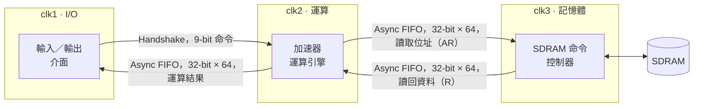

# 三時脈域加速器與 CDC

[English](README.md)

ICLAB Lab 07 · 2026 春季 · Verilog · JasperGold CDC · 成績 95 / 100

一個從 DRAM 讀取資料來運算的加速器，I/O 介面、運算引擎和 DRAM 控制器各自跑在互不同步的 clock 上。這個 lab 的重點是讓資料在這些 clock 之間安全又有效率地傳遞。

## 時脈域與跨域路徑

| 跨域路徑 | 同步器 | 為什麼選它 |
| --- | --- | --- |
| clk1 → clk2，命令 | Handshake（req/ack 各經過兩級 flip-flop 同步） | 一次只傳一筆小資料，來回幾個 cycle 可以接受，面積很小 |
| clk2 → clk1，結果 | Async FIFO，64 格 | 結果連續輸出，每筆都 handshake 會卡住吞吐量 |
| clk2 → clk3，讀取位址 | Async FIFO，64 格 | 運算引擎可以先排好多個位址給記憶體端 |
| clk3 → clk2，讀回資料 | Async FIFO，64 格 | DRAM 成批回傳，運算引擎依自己的速度消化 |

## 設計重點

- **FIFO 指標用 Gray code。** 每個指標經過兩級 flip-flop 的 bus 同步器跨域。Gray code 每次只變一個 bit，所以就算在轉換中被取樣，拿到的也只會是舊值或新值，不會是錯誤的組合。full 和 empty 因此可能偏保守，但不會判斷錯。
- **FIFO 讀出資料再打一拍。** 雙埠記憶體的輸出在讀取端的 clock 下再存一級暫存器，避免未同步的路徑進入讀取端邏輯。
- **Handshake 資料穩定。** 來源端的資料從送出 request 到收到 acknowledge 都保持不變，而且要等前一次 acknowledge 放掉才送下一個 request。
- **記憶體端。** clk3 的控制器直接送出 SDRAM 命令（CS#、RAS#、CAS#、WE#、bank、位址），並遵守 tRCD、tCL、tRP。它記住 4 個 bank 各自開著的 row，row 命中時跳過 PRE 和 ACT，直接 READ。

## 用 JasperGold 做 CDC 驗證

1. **結構分析：** 找出全部 4 組 clock pair，每一條跨域路徑都對應到 handshake 或 FIFO 方案，沒有 convergence 問題。
2. **功能分析：** JasperGold 針對這些同步方案自動產生 11 條 protocol property，全部以 unbounded proof 證明成立，例如：
   - FIFO full 時不寫入、empty 時不讀出；
   - 讀寫指標每次只變一個 bit；
   - Handshake 的 request 在收到 acknowledge 前保持住、acknowledge 放掉前不送新 request、request 等待期間資料保持穩定。

這些證明表示同步器**使用方式正確**，但不能也無法證明 metastability 永遠不會發生；那取決於同步器的級數和 MTBF。

---

因為課程會沿用這個題目，RTL 不公開。面試需要時可以提供。
