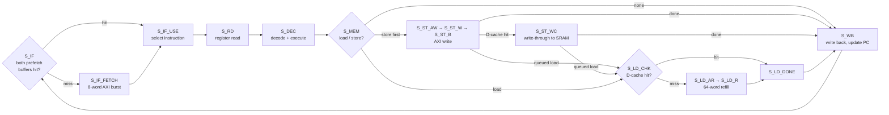

# Dual-Core 16-bit RISC CPU — RTL to GDSII

[中文版](README.zh-TW.md)

ICLAB Final Project, Spring 2026 · UMC 180 nm · Verilog

Two 16-bit MIPS-like cores, each with 8 general-purpose registers, fetch from their own instruction DRAM and share **one** data DRAM through AXI4. The design was taken from RTL through synthesis, power analysis and place-and-route to a sign-off-clean layout.

## The problem

| Constraint | Value |
| --- | --- |
| Instruction set | 15 instructions: 8 R-type ALU ops, 16×16 signed multiply, ADDI, SUBI, LOAD, STORE, BEQ, JUMP |
| Interfaces | 3 AXI4 masters: instruction DRAM ×2, shared data DRAM ×1 (16-bit data bus, INCR bursts) |
| Memory latency | Instruction DRAM 96–128 cycles, data DRAM 256–512 cycles, not fixed |
| Ordering rules | Both cores execute in instruction-count order. At the same count, a store completes before the other core's load, and only one core may store. |
| Grading | (cycles × period × area) and (cycles × period × average power × peak power) |

The ALU is easy. The hard parts are hiding a 256–512-cycle data memory, keeping two cores consistent on one memory, and keeping peak power low.

## Architecture

Both cores advance through one shared multi-cycle FSM, which makes the cross-core ordering rules hold by construction.

| Block | Implementation | Why |
| --- | --- | --- |
| Instruction fetch | One 8-word (16-byte) register prefetch buffer per core, tagged by `pc[15:4]`, filled by an 8-beat AXI burst | Short loops run from the buffer with zero DRAM cost, without an SRAM macro |
| Data cache | One 64×16 single-port SRAM holding a single 64-word line, 9-bit tag (`addr[15:7]`), refilled by one 64-beat burst | Loads and stores stay within ±200 of the previous address, so one large line exploits that locality and amortizes the 256–512-cycle latency |
| Write policy | Write-through; on a store hit the SRAM is updated in the same transaction | DRAM always holds the newest value, which the testbench checks every 50 instructions |
| Memory queue | 2 entries; the store is always placed first | At most one store and one load per instruction count, so two entries are sufficient |
| Multiply | 16×16 → 32-bit signed, written to two registers (`rd`, `rl`) in write-back | Matches the MULT instruction format |

## Design decisions

### 1. Three SRAMs down to one, for peak power

The first working version used three SRAM macros: one instruction cache per core and one data cache. PrimeTime PX showed a peak power about three times my classmates' designs. The power report pointed at the SRAMs being accessed in the same cycle.

I replaced both instruction SRAMs with small register-based prefetch buffers and kept a single SRAM as the data cache. The chip-select of that SRAM is also driven low in every FSM state that does not touch it (fetch, register read, decode, write-back, and AXI waits).

**Trade-off:** registers cost more area per bit than SRAM, and the instruction buffer only covers 8 words, so a loop longer than 16 bytes refetches. Because the score multiplies average power by peak power, removing the peak was worth it.

### 2. A dedicated register-read stage, for timing

Synthesis reported the critical path from the instruction register, through the 8-to-1 register-file read multiplexer and the ALU, into the write-back register, with zero slack at 6 ns. I split register read into its own FSM state (`S_RD`), so read and execute land in different cycles and that path gains margin.

### 3. Correct by construction rather than forwarding

Because both cores share one FSM, they never get ahead of each other. The store-before-load and exclusive-store rules then reduce to ordering two entries in the memory queue, with no forwarding or hazard logic between cores. The cost is that a core waiting on a cache miss also stalls the other.

## Results

| Metric | Value |
| --- | --- |
| Clock period | 6 ns |
| Chip area (Innovus) | 0.73 mm² |
| I/O pins | 460 |
| Sign-off | No setup/hold violations incl. SI, DRV 0, clean DRC, connectivity and LVS |
| Ranking | Top 36% of the class (performance score) |

## Verification

- TA-provided pattern at RTL, gate level (with timing checks) and post-layout.
- My own [constrained-random generator](tools/gen_pattern.py) for both instruction DRAMs and the data DRAM. It never lets both cores store at the same instruction count, so it stresses the store/load ordering path.

## What I would do next

- Measure the D-cache hit rate per test program, and compare one 64-word line against several smaller lines in the same SRAM.
- Let the core that hits continue while the other core waits on a miss, inside the ordering rules.
- Replace the manual chip-select gating with integrated clock-gating cells on the register banks.

---

RTL is not published because the course reuses this assignment. It is available to interviewers on request.
