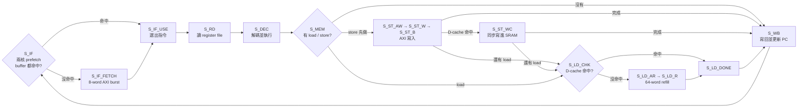

# 雙核 16-bit RISC CPU — RTL 到 GDSII

[English](README.md)

ICLAB Midterm 與 Final Project · 2026 春季 · UMC 180 nm · Verilog

兩顆 16-bit、類 MIPS 的核心，各自有 8 個通用暫存器，從各自的 instruction DRAM 取指令，並透過 AXI4 **共用同一顆** data DRAM。期中專題完成 RTL 和自己撰寫的 testbench；期末專題把同一顆 CPU 做完合成、功耗分析和 APR，得到通過 sign-off 檢查的 layout。

## 題目限制

| 限制 | 內容 |
| --- | --- |
| 指令集 | 15 條：8 條 R-type ALU 運算、16×16 有號乘法、ADDI、SUBI、LOAD、STORE、BEQ、JUMP |
| 介面 | 3 個 AXI4 master：instruction DRAM ×2、共用 data DRAM ×1（16-bit data bus，INCR burst） |
| 記憶體延遲 | instruction DRAM 96–128 cycle，data DRAM 256–512 cycle，每次不固定 |
| 順序規則 | 兩核依 instruction count（IC）順序執行；同一個 IC 時，store 必須比另一核的 load 先完成，且只能有一核做 store |
| 評分 | （cycle 數 × 週期 × 面積）與（cycle 數 × 週期 × 平均功耗 × peak power） |

ALU 很簡單。真正的難點是：藏住 256–512 cycle 的 data memory 延遲、讓兩核在同一顆記憶體上保持一致，以及壓低 peak power。

## 架構

兩核共用同一個多週期 FSM 一起前進，所以跨核的順序規則在結構上就自然成立。

| 區塊 | 實作 | 原因 |
| --- | --- | --- |
| 取指令 | 每核一個 8-word（16 byte）的暫存器 prefetch buffer，以 `pc[15:4]` 當 tag，用 8-beat AXI burst 填滿 | 短迴圈直接從 buffer 跑，不用存取 DRAM，也不需要 SRAM macro |
| Data cache | 一顆 64×16 單埠 SRAM，存一條 64-word 的 line，9-bit tag（`addr[15:7]`），用一次 64-beat burst 補滿 | 題目保證 load/store 位址落在前一個位址 ±200 內，一條大 line 能利用這個區域性，攤平 256–512 cycle 的延遲 |
| 寫入策略 | Write-through；store 命中時同時更新 SRAM | DRAM 永遠是最新值，testbench 每 50 條指令會檢查 DRAM 內容 |
| Memory queue | 2 格，store 一律排在前面 | 同一個 IC 最多一筆 store 加一筆 load，兩格就夠 |
| 乘法 | 16×16 → 32-bit 有號乘法，寫回時分成 `rd`、`rl` 兩個暫存器 | 對應 MULT 指令格式 |

## 設計決策

### 1. SRAM 從 3 顆減到 1 顆，壓低 peak power

第一個能動的版本用了 3 顆 SRAM macro：兩核各一顆 instruction cache，再加一顆 data cache。PrimeTime PX 量到平均功耗 63.9 mW、peak power 337.4 mW，其中 SRAM macro 占平均功耗的 87.6%。

我把兩顆 instruction SRAM 換成小型的暫存器 prefetch buffer，只保留一顆 64×16 SRAM 當 data cache。SRAM macro 面積從 167,384 µm² 降到 47,941 µm²（−71%），合成總面積從 332,480 µm² 降到 252,831 µm²（−24%）。這顆 SRAM 的 chip-select 也在所有用不到它的 FSM 狀態拉低，包括取指令、讀暫存器、解碼、寫回和等待 AXI 的狀態。

經過這幾版修改，peak power 從 337.4 mW 降到 115.6 mW（−66%），平均功耗從 63.9 mW 降到 12.1 mW（−81%），而且時脈還變快了。

**取捨：** 暫存器每個 bit 的面積比 SRAM 大，而且 instruction buffer 只有 8 word，迴圈超過 16 byte 就要重新抓。但評分是平均功耗乘上 peak power，消掉尖峰比較划算。

### 2. 把讀 register file 獨立成一拍，改善時序

較早的版本在 6 ns 剛好達標（slack 為 0），critical path 從 instruction register 出發，經過 8 選 1 的 register file 讀取 mux 和 ALU，進到寫回暫存器。我把讀暫存器拆成獨立的 FSM 狀態（`S_RD`），讓讀取和運算落在不同 cycle；再加上記憶體系統變小，最終版本在 **4.4 ns** 達標，快了 27%。

### 3. 依實測 peak power 決定 power ring 寬度

Power ring 的供電能力必須大於 PTPX 量到的 peak power，換算方式是每 µm 寬度 1 mA、電壓 1.8 V。用 7 組 interleaving 時，最小寬度 9 µm 只能供 113.4 mW，低於 115.6 mW 的 peak。加寬到 9.18 µm 可供 115.67 mW，剛好通過，同時讓 ring 盡量窄。

### 4. 用結構保證正確，而不是靠 forwarding

因為兩核共用一個 FSM，任一核都不會跑到另一核前面。store-before-load 和「同一時間只能一核 store」這兩條規則，就簡化成 memory queue 裡兩筆存取的排序，核心之間不需要 forwarding 或 hazard 偵測。代價是一核在等 cache miss 時，另一核也要跟著等。

## 結果

| 指標 | 數值 |
| --- | --- |
| 時脈週期（合成與 post-layout） | 4.4 ns |
| 總 cycle 數（測試程式） | 102,919 |
| 合成面積 | 252,831 µm²（其中 SRAM 47,941 µm²） |
| 晶片面積（Innovus） | 0.729 mm² |
| 平均／peak power（PTPX） | 12.1 mW / 115.6 mW |
| Power ring | 7 組 × 9.18 µm，可供 115.67 mW |
| I/O pin 數 | 460 |
| Sign-off | 含 SI 的 setup/hold 無 violation，DRV 為 0，DRC、connectivity、LVS 全部通過 |
| 排名 | 全班前 36%（performance 分數） |

## 驗證

期中專題要求自己寫 testbench，期末設計也沿用它驗證。

- **Golden model：** 先用行為級的 ISA 模擬器跑一遍產生的程式，記下每條指令後的所有暫存器，以及每 50 條指令的 data memory，testbench 再拿 DUT 跟這些快照比對。
- **程式產生：** 依照實際的 PC 走向產生指令，所以往回跳的 BEQ 迴圈和往前的 JUMP 都能安全放置，每個 LOAD/STORE 位址都用當下的 golden 暫存器值檢查過。
- **Corner case：** 同一個 IC 兩核對同一位址 store/load 的衝突、兩核 load 同一位址、有號 SLT、大數 MULT，以及往回跳之後的 I-cache miss。
- **規模：** 6 輪、不同 seed，約 25,000 條執行指令，另外有 AXI handshake 和回應延遲的監測。
- 早期 bring-up 時用 [Python 產生器](tools/gen_pattern.py) 產生 DRAM 內容。
- TA 的 pattern 也跑過 RTL、gate-level（開 timing check）和 post-layout。

## 下一步可以做的改進

- 量測每個測試程式的 D-cache 命中率，比較「一條 64-word line」和「同一顆 SRAM 切成多條小 line」的效果。
- 在符合順序規則的前提下，讓命中的核心先往下跑，不必等另一核的 miss。
- 用 integrated clock-gating cell 取代手動的 chip-select gating，套用到暫存器上。

---

因為課程會沿用這個題目，RTL 不公開。面試需要時可以提供。
